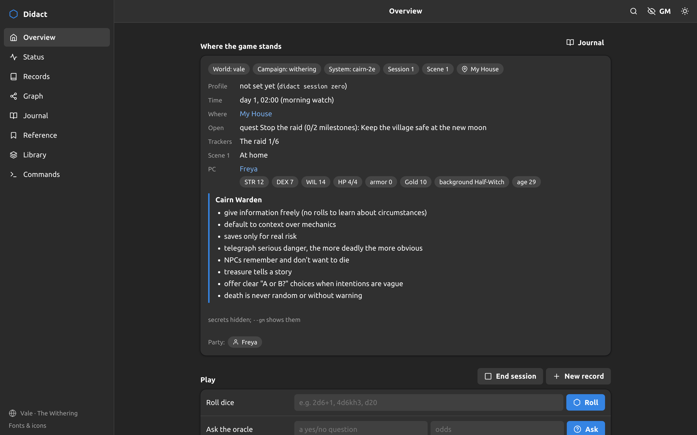

# Didact

**A game master's memory, dice and rulebook, made for LLMs.** Didact lets an LLM (Claude first, any LLM through the CLI or MCP) run solo tabletop RPGs, for any game system. The LLM narrates. Didact holds the truth and does the hard parts: records, dice, rules, oracles, time and memory.

- **Any system.** Rules, sheets, tables, oracles and generators are data in *packs*. A pack is YAML plus optional Python, and packs can be shared as `.didactpack` files.
- **Nothing made up.** Every roll happens in Didact and is logged, replayable and auditable. Every change is validated, logged and undoable, down to "take back everything since my last message".
- **A world that stays consistent.** Every NPC, place, item, quest and faction is a Markdown file you can read and edit (it opens in Obsidian). Each one keeps the GM's hidden notes: what it wants, what it's doing and plans next, where it is, what happened to it. Items know where they are, even in a chest in a house.
- **Secrets stay secret.** Views are player-safe by default; the GM's view shows everything.
- **Look it up, don't recall it.** Rules text, terms, tables, records, the transcript and Didact's own docs are all searchable, forgiving typos and finding synonyms.
- **Describe it, get it.** Characters, monsters, items, places and whole worlds are created from a description, with the system's own procedures rolling what the rules decide.
- **In your language.** The browser app (everything it shows, commands' output included) and its guides come in 24 languages; choose on its Settings page. The command line speaks English, what LLMs read best and use, unless a call asks for another language (`DIDACT_LANG=fr didact brief`). `export --lang` writes the player website and the story in any of them.
- **A browser app.** `didact serve` shows where things stand at a glance (the party, the fight, quests, where you are), lets you explore and edit everything, see how it all links in a graph or on a map of the world, create characters and run generators step by step, jump back to any point in the history, and run any command from forms. See [The browser app](#the-browser-app).
- **Share what the players know.** `didact export --as site` writes it as a small website, to read on a phone or pass around.
- **Take it elsewhere.** `didact export --as lonelog` writes the journal in Lonelog notation, `didact lore export` and `lore import` trade lorebooks with SillyTavern, KoboldAI and NovelAI, and `didact world export --as setting` turns a world into a setting pack for your next one.
- **Backed up.** Each session's end saves a backup of the library, and `didact snapshot --restore` brings one back.

Didact never calls an LLM. It returns results, prompts and structure, and the LLM writes the prose.



## Install

Didact needs Python 3.14 and [uv](https://docs.astral.sh/uv/).

```
git clone https://github.com/vess-dev/Didact.git && cd Didact
uv tool install --editable '.[mcp]'      # the `didact` and `didact-mcp` commands
didact doctor                            # checks this machine
didact setup thesaurus                   # optional: synonyms in searches (English WordNet, about 110 MB)
```

Your library (worlds, campaigns, records and logs) lives in `~/Documents/DidactLibrary`. Set `DIDACT_HOME` to keep it elsewhere.

To update Didact, `git pull` in its folder.

## Uninstall

Your games live in your library, apart from the program, so removing Didact doesn't touch them unless you delete the library too. Do the steps that use `didact` before removing the program:

1. **Claude Code:** if you let it run Didact without asking, take that out: `didact setup claude --remove`. If you added the plugin, `/plugin uninstall didact@didact`, then `/plugin marketplace remove didact`.
2. **Claude Desktop and other MCP clients:** delete the `didact` entry from the client's config (Claude Desktop's is `~/Library/Application Support/Claude/claude_desktop_config.json`).
3. **The caches:** `didact cache show` says where they are: `~/Library/Caches/didact` on macOS, `~/.cache/didact` on Linux, `%LOCALAPPDATA%\didact\Cache` on Windows (or wherever `DIDACT_CACHE` points). Delete that folder (the search indexes, compiled packs, the thesaurus and the code's documentation), and `didact-demo` beside it, the demo's library.
4. **The program:** `uv tool uninstall didact`, then delete the Didact folder you cloned.
5. **Your library**, only if your games should go too: `~/Documents/DidactLibrary`, or wherever `DIDACT_HOME` points. Its `backups/` folder holds its backups (`didact snapshot` makes one): copy one somewhere safe first if you might want your games back.

## Packs

A new library has only `core`, the base every system builds on. The other packs that ship with Didact wait in its `packs/` folder until you install them, from the browser app's Library page or the command line:

```
didact pack list                   # what's installed, and what ships ready to install
didact pack install <pack>         # a pack that ships with Didact, by its id (or a .didactpack file, a folder, a URL)
didact pack update                 # newer versions of the installed packs, here and on GitHub
didact pack uninstall <pack>       # remove it again
```

An update installs beside the old version, so a campaign keeps the rules it started with until `didact campaign upgrade`. `didact guide packs` explains writing your own.

## Play with Claude

- **Claude Code:** run `claude --plugin-dir ./claude`, or add this repo as a plugin marketplace (`/plugin marketplace add <path to Didact>`, then `/plugin install didact@didact`).
  - The plugin brings the skill, hooks and slash commands. The hooks brief Claude when a session starts, capture the transcript, surface lore, and approve plain `didact` commands.
  - Without the plugin's hooks, `didact setup claude` lets Claude Code run plain `didact` commands without asking; `didact setup claude --remove` takes that out again.
  - Workflows: `/didact:start`, `/didact:end`, `/didact:new-campaign`.
  - Quick looks: `/didact:sheet`, `/didact:recap`, `/didact:roll`, `/didact:rules`, `/didact:map`, `/didact:undo`.
- **Claude Desktop and other MCP clients:** add `didact-mcp` to the client's config, as in `claude/mcp.example.json`.
- **Other LLMs and agents:** see [AGENTS.md](AGENTS.md).

Then just say what you want to play: "Let's start a new campaign."

To look around first, `didact serve --demo` opens a sample campaign in your browser, freshly built each time and apart from your own library.

## The browser app

`didact serve` opens your library in a web browser: a place for the player at the table to see the game and work with it, beside the LLM that runs it. It uses the same library through the same commands, so everything it does is checked, logged and undoable, and it shows each command it ran.

```
didact serve --open          # start it and open a browser tab: http://127.0.0.1:8765/
didact serve --gm            # start with the GM view on
didact serve --demo          # a fresh sample campaign to try things on, apart from your library
didact serve --port 9000     # another port; Ctrl-C stops it
```

- **Overview and Status:** where the game stands: the session and scene, the time (advance it by so many hours, watches or days), reminders, each party member's numbers (− and + them) and what they carry, the fight, quests and trackers, and where the party is.
- **Records:** every person, place and thing, with forms to change them. Character creation and generators go a question at a time, with a Back button, and every choice says what it means (what a background gives, what a talent does).
- **Graph and map:** how the records link, and the places the party knows, with the paths between them.
- **Journal:** the sessions, scenes, beats and rolls.
- **Reference:** search everything, run the rules from forms, roll the tables, and read the rules text, the glossary and the guides.
- **Library:** worlds and campaigns, packs (each says what it is), save points, backups and the history: undo a change, or jump back to any point and take back everything after it.
- **Commands:** every command as a form; the boxes take only what fits (an id, a number, a record from a list).
- **Settings:** the campaign's options (each says what it does), the app's language, and the thesaurus.

It shows what the players know. The **GM** button in the header bar shows the secrets and the GM's notes too, and a banner says so. It listens only to this computer, and every change needs a form from the app itself. `didact guide web` has the details.

## A taste of the command line

```
didact world new vale --system my-system        # a world, with the system it plays
didact campaign new withering
didact char new --mode random                   # the system's own character creation
didact session start                            # the brief: time, place, party, what's due
didact scene new 'The drowned mill'
didact do save who=freya attr=DEX               # a rule: rolled, logged, applied
didact roll '2d6+1'                             # any dice, logged as #r12
didact ask 'Is the miller home?' --odds likely  # the oracle
didact about miller plan='flee to the city' wants='his daughter back'
didact log consequence 'The miller lied to Freya' --about miller --about freya
didact inv move freya 'silver key' chest        # items know where they are
didact where 'silver key'                       # silver key: in Chest › at The Mill
didact undo --turn                              # take back everything since the last message
didact serve --open                             # the browser app
```

`didact commands` lists every command, and `didact help <command>` explains one.

## Learn more

- `didact guide play`: the play loop (sessions, scenes, turns, secrets, the map).
- `didact guide details`: the GM's notes, the chronicle, and where things are.
- `didact guide dice`: the dice notation.
- `didact guide packs`: writing a pack for your own game (rules, sheets, tables, oracles, generators).
- `didact guide web`: the browser app.
- `didact pack list`: the packs installed, and those that ship with Didact, ready to install (`didact pack install <pack>`, or the Library page). Each pack's own guide is `didact guide <pack>`.

## Where things are

The Didact folder:

```
src/didact/     the code: core, storage, the rules engines, services, commands, CLI, MCP server, browser app
  guides/       the guides behind `didact guide <topic>`, and their translations (guides/<language>/)
  locale/       the browser app's translations (gettext catalogs)
packs/          core, and the packs that ship with Didact: each as a folder and a ready-to-install .didactpack
claude/         the Claude Code plugin: the skill, hooks and slash commands
tests/          the tests, and small test packs in tests/fixtures/packs
tools/          developer tools (translation upkeep)
docs/           images for this README
AGENTS.md       how any LLM plays with Didact
CLAUDE.md       the guide to the code
```

Your library (`~/Documents/DidactLibrary`):

```
state.yaml                        the active world and campaign
log/events.jsonl                  every change and roll, in order: history, undo, save points
packs/<pack>/<version>/           installed packs
worlds/<world>/world.yaml         a world: its system, calendar and settings
worlds/<world>/<type>/<name>.md   its records, one Markdown file each (npc, loc, item, faction, quest, lore, …)
worlds/<world>/campaigns/<name>/  a campaign: its PCs, sessions, scenes, journal and transcripts
global/, systems/<pack>/          records and homebrew shared by every world, or by one system's worlds
backups/                          snapshots of the library (`didact snapshot`)
```

Records are plain Markdown with YAML front matter: open the library in any editor or in Obsidian. The search index lives in your cache folder and rebuilds itself.

## Working on Didact

```
uv sync --all-extras
make check          # format, lint, mypy --strict, tests: must be green
make skill          # after changing a command's help or a guide: regenerates the plugin's copies
make packs          # after changing a pack that ships: rebuilds its .didactpack and packs/index.json
make docs           # the code's API documentation (`didact docs build`)
make i18n           # after changing the browser app's words: updates the translation catalogs
make clean          # remove developer caches (mypy, ruff, pytest, __pycache__, pack builds)
```

`didact docs build` builds the code's API documentation (pdoc) into Didact's cache folder, and `didact docs status` says whether it's current; the browser app's code button opens it, rebuilding it first if the code changed.

`didact cache clear` deletes Didact's own caches (search indexes and compiled packs), which rebuild by themselves; `didact cache show` says what's there.

[CLAUDE.md](CLAUDE.md) is the guide to the code: architecture, conventions and how to add things. It's written for coding agents, and it works for people too.

## License

Didact is free for personal and other noncommercial use under the [PolyForm Noncommercial License 1.0.0](LICENSE): you may use, change and share it, but not sell it or use it commercially. Each pack in `packs/` keeps its own license, declared in its `pack.yaml`.
